# Laboratorios — Parte A

El Maratón es acumulativo: las capturas del estado final sirven para varios laboratorios y se identifican como tales. Cada sección distingue lo ejecutado de las variantes de código incorrecto que solo se analizaron. Los resultados verificables se conservan en pruebas-http.json, pruebas-sql.json y pruebas-bases.json.

## 1. Proyectos base: conceptos de React

Código: `proyectos-base/conceptos-react`.

### Explique el recorrido

| #   | Pieza            | Qué hace                                                 |
| --- | ---------------- | -------------------------------------------------------- |
| 1   | Padre            | Define los datos de técnicos y solicitudes.              |
| 2   | Props / children | Entrega valores y contenido a componentes reutilizables. |
| 3   | map y key        | Produce listas con identidad estable.                    |
| 4   | Evento           | Ejecuta el manejador pasado como función.                |
| 5   | Setter           | Actualiza el estado sin modificar el arreglo anterior.   |
| 6   | Render           | React recalcula el JSX y sincroniza el DOM.              |

### Reflexiona y explicación

Props son entradas de solo lectura. children es el contenido anidado. map genera elementos con key estable. El estado recuerda datos entre dibujos; un valor derivado se calcula desde ellos.

### Experimentos y observaciones

Ejecutado: Siguiente cambió Turno 1 a 2; Pausar desactivó Siguiente. Se agregó «Preparar defensa» sin perder las tareas anteriores. Seleccionar Luis mostró su ficha. Con filtro Ocupados, marcar disponible a Luis dejó «Disponibles: 4 de 4» y lista vacía. No se ejecutaron las variantes deliberadamente incorrectas de key, onClick ni preventDefault.

### Capturas del resultado acumulativo

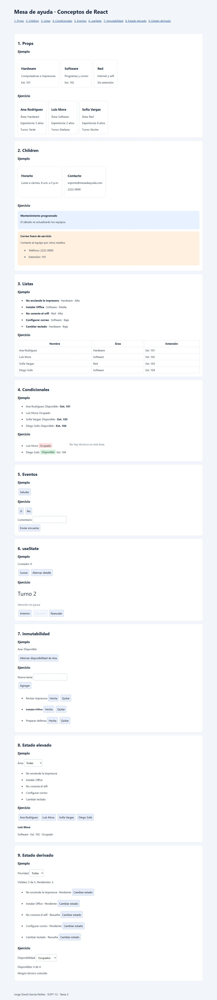

## 2. Registro y consulta de solicitudes

Código: `proyectos-base/solicitudes`.

### Explique el recorrido

| #   | Pieza         | Qué hace                                                                                            |
| --- | ------------- | --------------------------------------------------------------------------------------------------- |
| 1   | Registro HTML | Recoge los campos y valida al enviar.                                                               |
| 2   | Objeto        | Agrupa nombre, departamento, problema, prioridad y descripción.                                     |
| 3   | localStorage  | JSON.stringify conserva los registros en el mismo origen.                                           |
| 4   | Consulta HTML | JSON.parse recupera los registros y el filtro deriva la lista.                                      |
| 5   | React         | PaginaRegistro y PaginaConsulta componen siete piezas sin lógica de registro, como pide esta etapa. |

### Reflexiona y explicación

Menu y ListaSolicitudes se reutilizan. class se convierte a className y for a htmlFor. La consigna limita la Parte 2 a composición estática; no exige registrar ni filtrar desde React.

### Experimentos y observaciones

Ejecutado: registrar una solicitud de prioridad Alta en HTML, cambiar a consulta y recargar conservó un registro. Baja mostró cero; Todas mostró uno. React mostró las dos páginas y los siete componentes de composición estática. No se atribuye persistencia al formulario estático de React.

### Capturas del resultado acumulativo

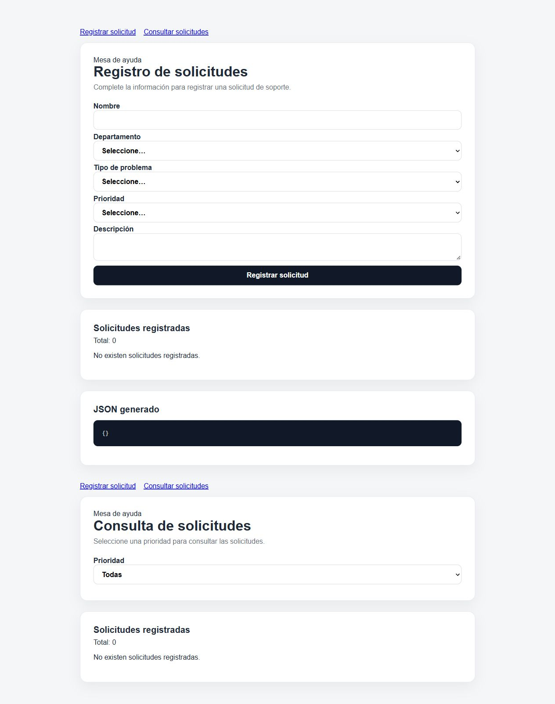

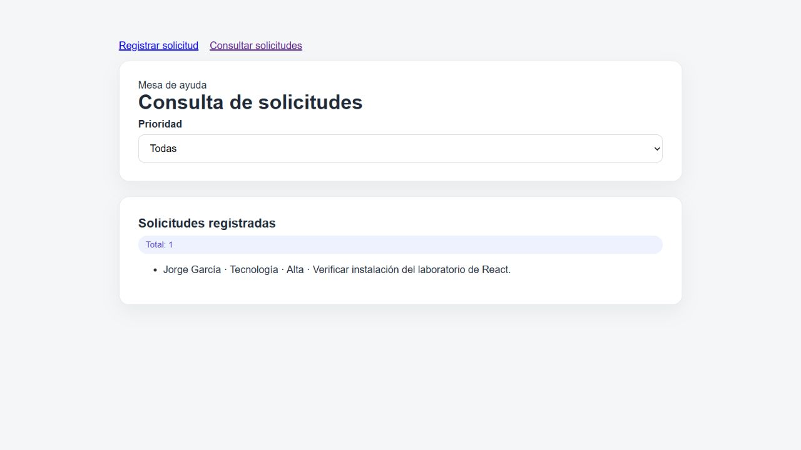

## 3. Montaje del Maratón

Código: `maraton-series/cliente`.

### Explique el recorrido

| #   | Pieza      | Qué hace                                                    |
| --- | ---------- | ----------------------------------------------------------- |
| 1   | index.html | Contiene root y carga main.jsx.                             |
| 2   | main.jsx   | createRoot monta React y BrowserRouter.                     |
| 3   | App        | Define el mapa de rutas.                                    |
| 4   | Layout     | Comparte el encabezado y coloca la página dentro de Outlet. |

### Reflexiona y explicación

Vite transforma JSX. main.jsx monta React en root. Bootstrap es una dependencia local. El cliente y el API tienen package.json independientes.

### Experimentos y observaciones

Ejecutado: Vite montó la aplicación y se abrió Inicio; build del cliente aprobado. Se mantuvieron proyectos npm independientes.

### Capturas del resultado acumulativo

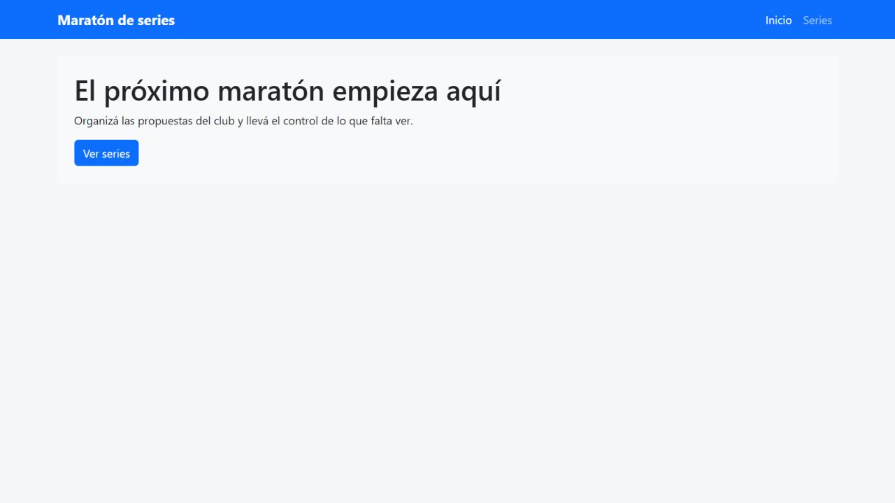

## 4. Armar el tablero con componentes

Código: `maraton-series/cliente/src/componentes`.

### Explique el recorrido

| #   | Pieza        | Qué hace                                            |
| --- | ------------ | --------------------------------------------------- |
| 1   | PaginaSeries | Posee datos y operaciones.                          |
| 2   | Panel        | Recibe titulo y children para el marco común.       |
| 3   | ListaSeries  | Usa map y key basada en _id.                        |
| 4   | TarjetaSerie | Presenta props y envía el id al callback del padre. |

### Reflexiona y explicación

Panel recibe titulo y children; ListaSeries convierte datos en tarjetas; TarjetaSerie avisa con el id y no modifica la base. El identificador estable es la key.

### Experimentos y observaciones

Ejecutado: cinco tarjetas y resumen; combinar Ana y Viendo mostró el mensaje de lista vacía. La misma captura acumulativa verifica composición y datos por props.

### Capturas del resultado acumulativo

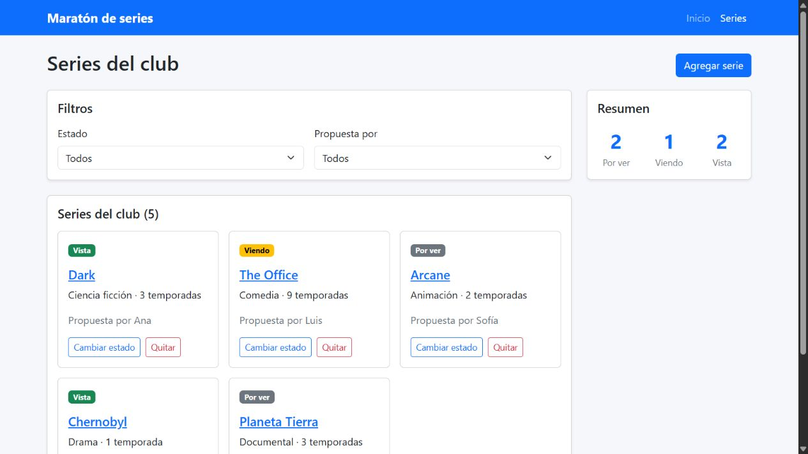

## 5. ¿Por qué no basta una variable?

Código: `maraton-series/cliente/src/paginas/PaginaSeries.jsx`.

### Explique el recorrido

| #   | Pieza          | Qué hace                                                  |
| --- | -------------- | --------------------------------------------------------- |
| 1   | Clic           | Dispara la función del botón.                             |
| 2   | Variable local | Reasignarla modifica memoria, pero no solicita un render. |
| 3   | useState       | El setter comunica el cambio a React.                     |
| 4   | Nuevo dibujo   | La lista y el resumen se vuelven a calcular.              |

### Reflexiona y explicación

Una variable normal no avisa a React y se reinicializa en el siguiente dibujo. El setter de useState conserva el dato y solicita un nuevo render.

### Experimentos y observaciones

Ejecutado en una reconstrucción aislada de esta etapa, sin API ni cambios en MongoDB: quitar Dark reasignó la variable a cuatro elementos en consola mientras siguieron visibles cinco. Con useState quedaron cuatro tarjetas visibles. El módulo temporal se retiró y se restauró la aplicación de Conceptos después de capturar el resultado.

### Capturas del resultado acumulativo

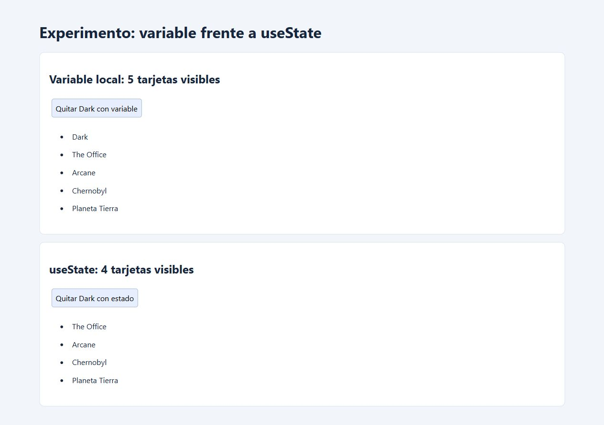

## 6. Cambiar estado y quitar con useState

Código: `maraton-series/cliente/src/paginas/PaginaSeries.jsx`.

### Explique el recorrido

| #   | Pieza                    | Qué hace                                                  |
| --- | ------------------------ | --------------------------------------------------------- |
| 1   | TarjetaSerie             | Invoca onAvanzar u onQuitar con el id.                    |
| 2   | Operación                | Espera la confirmación del API en la versión acumulativa. |
| 3   | map / filter             | Crea una lista nueva con el cambio o sin la serie.        |
| 4   | setSeries(actuales => …) | Aplica el resultado sobre la lista vigente.               |
| 5   | Render                   | Actualiza tarjetas, cantidad y resumen.                   |

### Reflexiona y explicación

filter devuelve otro arreglo sin la serie eliminada. map conserva las demás referencias y copia el objeto que cambia. El spread debe ir antes del campo actualizado. No se usa push ni splice sobre el estado.

### Experimentos y observaciones

Ejecutado: creación, cambio de estado y eliminación desde React; recarga conservó el resultado. La prueba HTTP recorrió Por ver → Viendo → Vista → Por ver sobre una serie desechable y consultó después de cada cambio.

### Capturas del resultado acumulativo

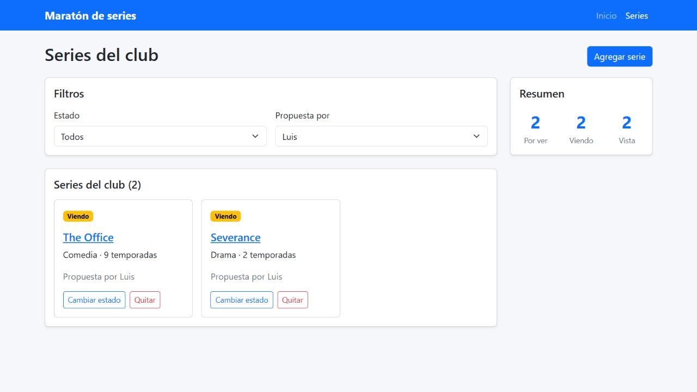

## 7. Filtros y resumen

Código: `maraton-series/cliente/src/componentes/filtros/Filtros.jsx`.

### Explique el recorrido

| #   | Pieza           | Qué hace                                                     |
| --- | --------------- | ------------------------------------------------------------ |
| 1   | Select          | Notifica el estado o miembro elegido.                        |
| 2   | useSearchParams | Actualiza el parámetro y conserva el otro.                   |
| 3   | Lista derivada  | Combina las condiciones con AND.                             |
| 4   | ListaSeries     | Muestra solo las coincidencias o el aviso vacío.             |
| 5   | Resumen         | Cuenta la lista completa, independientemente de los filtros. |

### Reflexiona y explicación

El estado se eleva al ancestro común. Lista visible y conteos no son estados adicionales. Los dos filtros se combinan con AND. El resumen cuenta la lista completa, no solo lo visible.

### Experimentos y observaciones

Ejecutado: cinco series iniciales; Por ver 2, Viendo 1, Vista 2. Filtro Viendo mostró The Office. Ana + Viendo mostró vacío. Los parámetros se conservaron tras recargar.

### Capturas del resultado acumulativo

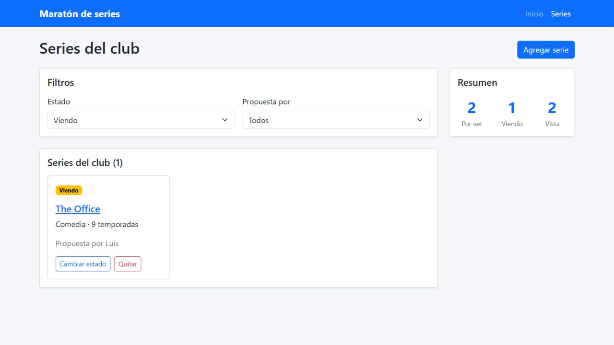

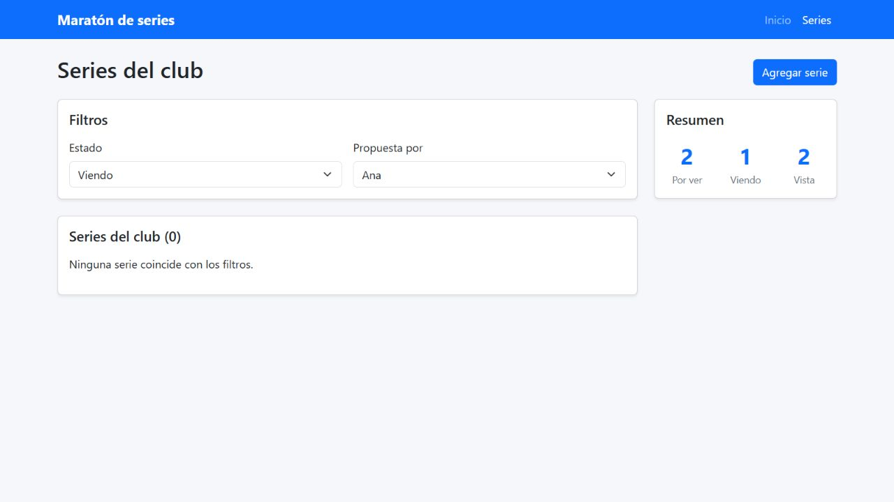

## 8. Formulario controlado

Código: `maraton-series/cliente/src/componentes/formulario/FormularioSerie.jsx`.

### Explique el recorrido

| #   | Pieza         | Qué hace                                           |
| --- | ------------- | -------------------------------------------------- |
| 1   | onChange      | Lee name y value del control.                      |
| 2   | setDatos      | Copia los demás campos antes de actualizar uno.    |
| 3   | submit        | preventDefault evita el envío tradicional.         |
| 4   | validarSerie  | Devuelve errores por campo.                        |
| 5   | onAgregar     | Espera la creación confirmada.                     |
| 6   | Éxito / error | Limpia solo al guardar; conserva valores si falla. |

### Reflexiona y explicación

value procede del estado y onChange lo modifica. Un solo manejador usa name para elegir la propiedad. preventDefault evita recargar. Los errores se muestran junto al campo. El id y estado inicial son responsabilidad del servidor.

### Experimentos y observaciones

Ejecutado: envío vacío mostró cuatro errores. Se comprobó una creación válida. HTTP rechazó temporadas 0, 31, 1.5 y texto "2". No se ejecutó la variante deliberada que omite el spread.

### Capturas del resultado acumulativo

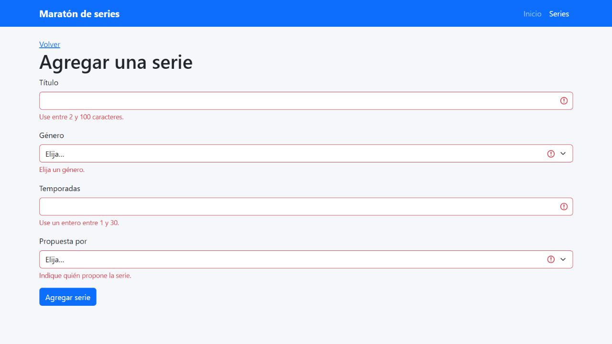

## 9. Consumo de APIs con JavaScript

Código: `proyectos-base/series-js`.

### Explique el recorrido

| #   | Pieza     | Qué hace                                                                    |
| --- | --------- | --------------------------------------------------------------------------- |
| 1   | submit    | Lee la búsqueda y muestra Buscando….                                        |
| 2   | api.js    | fetch espera la respuesta y revisa response.ok.                             |
| 3   | JSON      | Convierte los resultados de TVmaze en series.                               |
| 4   | render.js | Crea tarjetas usando textContent.                                           |
| 5   | Propuesta | POST a JSONPlaceholder muestra un registro simulado, sin persistencia real. |

### Reflexiona y explicación

fetch no lanza un error solo por recibir 404: hay que revisar ok. textContent evita interpretar contenido externo como HTML. JSONPlaceholder simula POST; no guarda propuestas de forma permanente.

### Experimentos y observaciones

Ejecutado: buscar dark mostró resultados reales de TVmaze; se observó Buscando… y una búsqueda inexistente mostró el estado vacío. El POST a JSONPlaceholder devolvió éxito simulado y limpió el formulario; la captura 23 conserva ese resultado y el estado vacío. No se simulan resultados del servicio externo.

### Capturas del resultado acumulativo

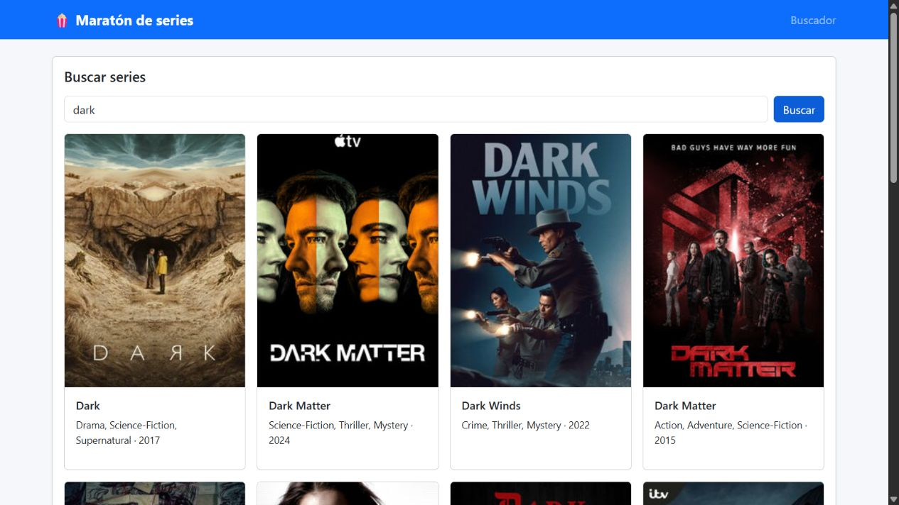

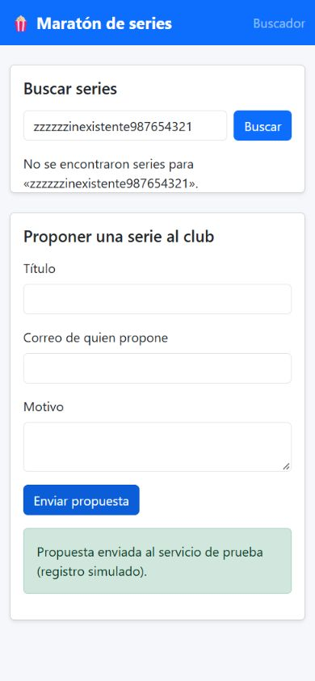

## 10. Estructura del API

Código: `maraton-series/servidor`.

### Explique el recorrido

| #   | Pieza      | Qué hace                                       |
| --- | ---------- | ---------------------------------------------- |
| 1   | index.js   | Lee configuración y conecta antes de escuchar. |
| 2   | app.js     | Compone middleware y módulos.                  |
| 3   | Router     | Selecciona método y ruta.                      |
| 4   | Controller | Traduce HTTP hacia el servicio.                |
| 5   | Service    | Aplica reglas.                                 |
| 6   | Repository | Consulta MongoDB.                              |

### Reflexiona y explicación

El cliente no conoce la contraseña de MongoDB. .env contiene configuración privada y .env.example contiene la plantilla. Cada capa tiene una responsabilidad y no se anidan los dos proyectos npm.

### Experimentos y observaciones

Ejecutado: comprobación de configuración incompleta y pruebas del servicio. El repositorio separa cliente, Express y .NET; cada petición atraviesa su módulo.

### Capturas del resultado acumulativo

## 11. El API escuchando peticiones

Código: `maraton-series/servidor/src/app.js`.

### Explique el recorrido

| #   | Pieza            | Qué hace                                                                |
| --- | ---------------- | ----------------------------------------------------------------------- |
| 1   | app.listen       | Recibe POST con JSON mal escrito.                                       |
| 2   | cors             | Añade las cabeceras para el origen del cliente.                         |
| 3   | express.json     | Falla al interpretar el cuerpo y propaga el error.                      |
| 4   | rutaNoEncontrada | No se ejecuta en este recorrido: Express salta al manejador de errores. |
| 5   | manejarErrores   | Devuelve 400 con codigo JSON_INVALIDO y mensaje legible.                |

### Reflexiona y explicación

1. **Petición y respuesta.** La petición contiene método, dirección, cabeceras y cuerpo opcional. La respuesta contiene estado HTTP, cabeceras y cuerpo opcional.

2. **next(new HttpError).** Centraliza la serialización del error y evita formatos distintos por ruta.

3. **Cuatro parámetros.** Express reconoce el manejador por (error, req, res, next).

4. **Orden.** CORS se ejecuta antes de las rutas para cubrir también sus errores; el manejador final recoge los fallos anteriores.

5. **codigo, mensaje y detalles.** codigo permite decidir al programa; mensaje explica al usuario; detalles enlaza errores con campos del formulario.

6. **Error 500.** El cliente recibe un mensaje general; la terminal conserva el detalle técnico sin revelar credenciales.

### Experimentos y observaciones

Ejecutado: JSON mal formado produjo 400 JSON_INVALIDO y una ruta inexistente produjo 404 RUTA_NO_ENCONTRADA. Evidencia detallada en pruebas-http.json.

### Capturas del resultado acumulativo

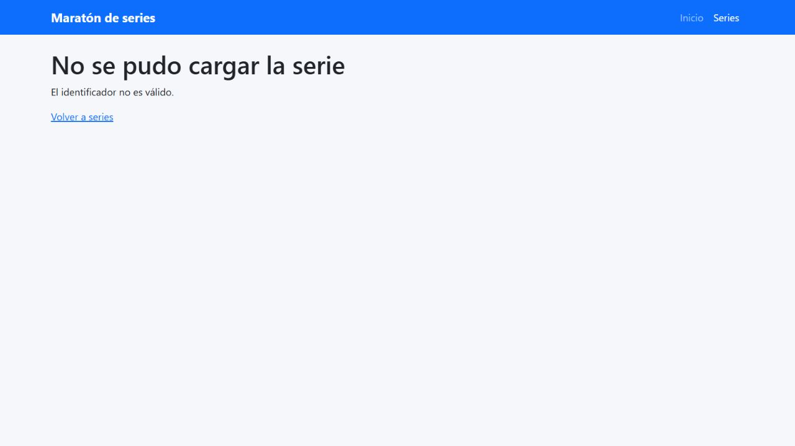

## 12. Conexión con MongoDB y módulo miembros

Código: `maraton-series/servidor/src/miembros`.

### Explique el recorrido

| #   | Pieza              | Qué hace                                              |
| --- | ------------------ | ----------------------------------------------------- |
| 1   | app.use            | Monta /api/miembros.                                  |
| 2   | miembros.routes.js | Relaciona GET / con listar.                           |
| 3   | Controller         | Espera servicio.listar().                             |
| 4   | Service            | Convierte _id a texto y conserva el contrato público. |
| 5   | Repository         | find con proyección, sort por nombre y toArray().     |
| 6   | MongoDB            | Devuelve los cuatro documentos.                       |
| 7   | Controller         | res.json envía el arreglo con estado 200.             |

### Reflexiona y explicación

1. **Cuatro capas.** Router: qué ruta y método. Controller: qué leer y responder por HTTP. Service: qué reglas aplicar. Repository: cómo consultar MongoDB.

2. **Servicio al listar.** Mantiene la separación y centraliza la conversión de ObjectId al contrato, aunque no haya una regla de negocio adicional.

3. **Ruta relativa /.** El prefijo /api/miembros ya lo aporta app.use; no se repite dentro del router.

4. **Cursor.** find devuelve una consulta recorrible, no el arreglo final. toArray ejecuta y materializa sus documentos; quitarlo impediría enviar el listado esperado.

5. **Colección incorrecta y 200.** Una colección sin datos permite una consulta válida que devuelve []; 200 no garantiza que el nombre de la colección sea el correcto.

6. **POST /api/miembros.** No existe un manejador POST para ese recurso. Coincidir en dirección no sustituye coincidir en método; cae en 404.

### Experimentos y observaciones

Ejecutado: Express respondió HTTP 200 a GET /api/miembros en el puerto 3001. MongoDB devolvió a Ana, Diego, Luis y Sofía en orden, con ObjectId convertidos a texto. El registro de pruebas HTTP y la captura muestran esa respuesta.

### Capturas del resultado acumulativo

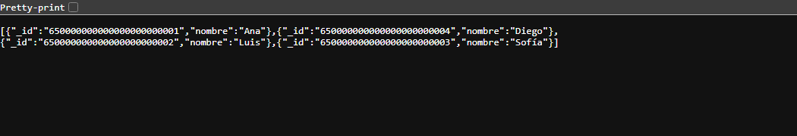

## 13. Series: listar y crear

Código: `maraton-series/servidor/src/series`.

### Explique el recorrido

| #   | Pieza                   | Qué hace                                                     |
| --- | ----------------------- | ------------------------------------------------------------ |
| 1   | express.json            | Convierte el texto recibido a req.body.                      |
| 2   | Router                  | Selecciona POST /api/series.                                 |
| 3   | Controller.crear        | Llama a servicio.crear con los datos.                        |
| 4   | validarSerie            | Comprueba título, género, temporadas y formato de miembroId. |
| 5   | miembros.service.existe | Verifica la referencia antes de insertar.                    |
| 6   | Service / Repository    | Elige campos permitidos, asigna Por ver e inserta.           |
| 7   | buscarPorId             | Une el miembro con $lookup y proyecta la serie.              |
| 8   | Controller              | Responde 201 con la serie confirmada, no con req.body.       |

### Reflexiona y explicación

1. **Servicio de miembros.** La comprobación pertenece a la interfaz del módulo; series no depende de cómo miembros guarda sus datos.

2. **Validación del servidor.** Puede recibir clientes distintos o peticiones manipuladas. La interfaz del navegador no protege la base.

3. **insertOne(req.body).** Permitiría asignar estado, ids o campos imprevistos; aquí se seleccionan explícitamente los datos aceptados.

4. **ObjectId.** MongoDB compara tipos; un texto con los mismos caracteres no equivale a un ObjectId almacenado.

5. **$lookup, $unwind y $set.** lookup obtiene el miembro relacionado, unwind convierte el arreglo de la unión en un documento y set/proyección extrae su nombre. Una referencia o colección incorrecta rompe el enriquecimiento.

6. **Respuesta 201.** Indica creación y entrega el recurso leído, con _id y estado asignados por el servidor.

### Experimentos y observaciones

Ejecutado: POST válido devolvió 201 con Por ver y nombre Ana. Miembro inexistente y temporadas inválidas devolvieron 400. Los campos adicionales no aparecieron en el contrato; estado enviado por el cliente no sustituyó Por ver. No se alteró temporalmente CON_MIEMBRO.

### Capturas del resultado acumulativo

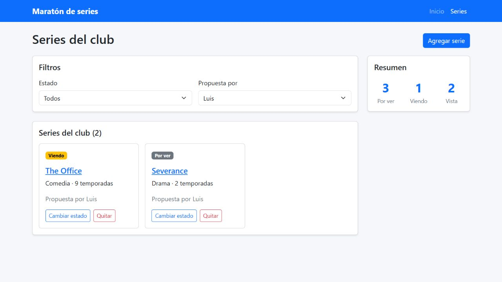

## 14. Series: cambiar estado y eliminar

Código: `maraton-series/servidor/src/series/series.service.js`.

### Explique el recorrido

| #   | Pieza                    | Qué hace                                                       |
| --- | ------------------------ | -------------------------------------------------------------- |
| 1   | app.use                  | Envía /api/series al módulo de series.                         |
| 2   | Router                   | Selecciona PATCH /:id/estado.                                  |
| 3   | Controller               | Lee id de params y estado de body.                             |
| 4   | revisarId                | Rechaza el formato inválido con 400.                           |
| 5   | Service                  | Comprueba que estado pertenezca al catálogo.                   |
| 6   | Repository.cambiarEstado | updateOne con $set; matchedCount distingue existencia.         |
| 7   | Repository.buscarPorId   | Recupera la serie actualizada y su miembro.                    |
| 8   | Controller               | Responde JSON 200; DELETE usa deletedCount y finaliza con 204. |

### Reflexiona y explicación

1. **Id y estado.** La dirección identifica qué recurso cambiar; el cuerpo expresa el dato nuevo de un PATCH.

2. **400 y 404.** revisarId detecta un formato inválido: 400. Un formato válido que no encuentra documento se detecta después de consultar: 404.

3. **utils/revisarId.** La validación de ObjectId es compartible por otros módulos, no una regla exclusiva de series.

4. **matchedCount.** Repetir el estado actual puede dar modifiedCount=0 con matchedCount=1: la serie existe y corresponde responder éxito.

5. **DELETE sin respuesta.** La base puede haber borrado mientras el cliente queda esperando. El controlador finaliza con res.status(204).end().

6. **Segundo DELETE.** Ya no hay documento y deletedCount=0: 404. Puede ocurrir desde otra pestaña o por repetir una operación.

### Experimentos y observaciones

Ejecutado: ciclo de estados, id inválido 400, id válido inexistente 404, estado Terminada 400; repetir el estado actual devolvió 200. Dos DELETE consecutivos devolvieron 204 y 404. No se ejecutó la variante de controlador que omite end().

### Capturas del resultado acumulativo

## 15. React lee el API

Código: `maraton-series/cliente/src/paginas/PaginaSeries.jsx`.

### Explique el recorrido

| #   | Pieza                 | Qué hace                                                  |
| --- | --------------------- | --------------------------------------------------------- |
| 1   | Primer dibujo         | Listas vacías y cargando=true.                            |
| 2   | useEffect / cargar    | Inicia las dos consultas después del montaje.             |
| 3   | obtenerSeries → pedir | fetch al API configurado en VITE_API_URL.                 |
| 4   | GET /api/series       | El servidor consulta MongoDB y responde 200.              |
| 5   | respuesta.json        | Espera y convierte el cuerpo.                             |
| 6   | Setters               | Guardan series y miembros; en error se guarda el mensaje. |
| 7   | finally               | Termina la carga también cuando hubo error.               |
| 8   | Segundo dibujo        | Muestra tarjetas, filtros y resumen o la alerta.          |

### Reflexiona y explicación

1. **API en .env.** Permite cambiar servidor entre entornos; el valor de respaldo solo facilita el modo local.

2. **Variables VITE\_.** Se incorporan al código entregado al navegador. Una URL pública es válida; una contraseña no.

3. **API apagado y CORS.** Ambos pueden hacer rechazar fetch. En Red/Consola se distingue conexión rechazada de respuesta bloqueada por la política del origen.

4. **useEffect.** La petición es un efecto externo después del render. Ponerla en el cuerpo provocaría consultas en cada dibujo y, al actualizar el estado, un ciclo.

5. **finally.** Termina Cargando tanto en éxito como en error.

6. **Persistir la creación.** Agregar debe enviar POST al servidor; guardar solo en React pierde la serie al recargar. La etapa final ya realiza el POST.

### Experimentos y observaciones

Ejecutado: montaje consultó los datos reales de MongoDB, mostró cinco series y permitió recargar. No se ejecutaron cambios deliberados de CORS ni la variante con petición dentro del cuerpo del componente.

### Capturas del resultado acumulativo

## 16. El formulario crea con POST

Código: `maraton-series/cliente/src/paginas/NuevaSerie.jsx`.

### Explique el recorrido

| #   | Pieza                          | Qué hace                                                                                                              |
| --- | ------------------------------ | --------------------------------------------------------------------------------------------------------------------- |
| 1   | FormularioSerie / validarSerie | Revisa los campos antes de enviar.                                                                                    |
| 2   | setEnviando(true)              | Desactiva el botón durante la petición.                                                                               |
| 3   | NuevaSerie / agregar           | Espera crearSerie; el estado final separa el formulario en una ruta.                                                  |
| 4   | crearSerie → pedir             | POST con method, Content-Type y JSON.stringify.                                                                       |
| 5   | API POST /api/series           | Valida, guarda y responde 201 o 400 con detalles.                                                                     |
| 6   | useNavigate                    | Vuelve a /series después del éxito; esa página vuelve a consultar. Sustituye el setSeries del App anterior al Router. |
| 7   | setDatos(VACIO)                | Solo se alcanza después del éxito; si hay 400 se conservan valores y se muestran detalles.                            |
| 8   | finally                        | Desactiva enviando aunque la petición haya fallado.                                                                   |

### Reflexiona y explicación

1. **fetch para enviar datos.** method POST, headers Content-Type application/json y body JSON.stringify. Sin cabecera el middleware no interpreta el cuerpo; sin stringify no viaja JSON válido.

2. **Primero el API.** La pantalla representa lo que se guardó y no anuncia éxito antes de confirmarlo.

3. **Sin catch en agregar.** El error debe propagarse al formulario, que conoce los campos y conserva lo escrito. En la versión con Router, NuevaSerie también deja llegar ese error.

4. **miembroId.** Es la referencia inequívoca; dos personas podrían compartir nombre.

5. **Dos validaciones.** La de React guía al usuario y la del servidor protege todas las entradas.

6. **Setter funcional.** En una lista acumulativa evita sobrescribir cambios llegados durante el await. En la ruta nueva, se navega y se consulta de nuevo al guardar.

### Experimentos y observaciones

Ejecutado: creación desde formulario y recarga mostraron la serie nueva. Una serie desechable con id 6b036e813e8afc9e8e00a2d6 sobrevivió al cambio de proceso 46704 → 22484. El borrado posterior siguió ausente tras reiniciar a proceso 29356. No se dejó el banco efímero como modo habitual.

### Capturas del resultado acumulativo

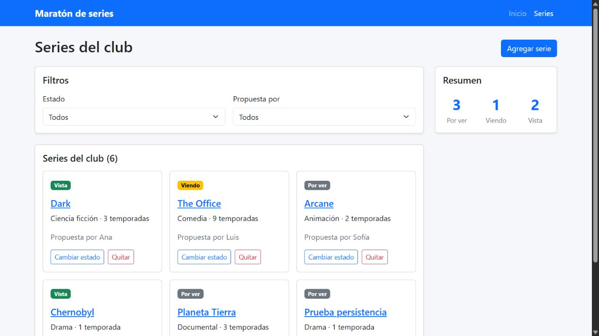

## 17. Cambiar estado y quitar desde React

Código: `maraton-series/cliente/src/paginas/PaginaSeries.jsx`.

### Explique el recorrido

| #   | Pieza                 | Qué hace                                                                             |
| --- | --------------------- | ------------------------------------------------------------------------------------ |
| 1   | TarjetaSerie / Quitar | Llama al callback con _id.                                                           |
| 2   | PaginaSeries / quitar | Bloquea clics repetidos por tarjeta y espera al API.                                 |
| 3   | eliminarSerie → pedir | Envía DELETE /series/:id.                                                            |
| 4   | Router → Controller   | Entrega el id al servicio.                                                           |
| 5   | Service.eliminar      | Valida el id y verifica deletedCount.                                                |
| 6   | Repository.deleteOne  | Elimina el documento por ObjectId.                                                   |
| 7   | pedir / 204           | Retorna null sin intentar leer JSON.                                                 |
| 8   | setSeries             | filter sobre la lista actual; los errores se muestran arriba y no quitan la tarjeta. |

### Reflexiona y explicación

1. **204 antes de json.** 204 no trae cuerpo: intentar parsearlo produce un error aunque el borrado haya funcionado.

2. **Serie confirmada.** El servidor es quien valida y devuelve el estado realmente guardado.

3. **Setter funcional.** Dos respuestas concurrentes se aplican a la lista vigente, evitando recuperar elementos ya eliminados.

4. **Catch en botones.** La página muestra sus errores; agregar deja propagarlos al formulario para mostrarlos por campo.

5. **Actualización optimista.** Acelera la sensación de respuesta, pero requiere revertir si falla. Esta implementación espera confirmación del servidor.

6. **Recurso nuevo.** Crear routes, controller, service y repository; montar el módulo en app.js; añadir funciones HTTP y componentes del cliente.

| Pantalla | Función HTTP                    | Ruta                            | Repositorio                 |
| -------- | ------------------------------- | ------------------------------- | --------------------------- |
| Abrir    | obtenerSeries / obtenerMiembros | GET /api/series y /api/miembros | listar                      |
| Agregar  | crearSerie                      | POST /api/series                | crear y buscarPorId         |
| Cambiar  | cambiarEstadoSerie              | PATCH /api/series/:id/estado    | cambiarEstado y buscarPorId |
| Quitar   | eliminarSerie                   | DELETE /api/series/:id          | eliminar                    |

### Experimentos y observaciones

Ejecutado: actualización y eliminación desde React persistieron al recargar; el borrado siguió ausente tras reiniciar. HTTP confirmó DELETE 204 sin cuerpo y segundo DELETE 404. No se ejecutaron las variantes de actualización optimista ni de respuestas concurrentes sin setter funcional.

### Capturas del resultado acumulativo

## 18. React Router

Código: `maraton-series/cliente/src/App.jsx`.

### Explique el recorrido

| #   | Pieza                | Qué hace                                                              |
| --- | -------------------- | --------------------------------------------------------------------- |
| 1   | TarjetaSerie / Link  | Declara la dirección /series/:id.                                     |
| 2   | BrowserRouter        | Actualiza el historial sin descargar otro documento HTML.             |
| 3   | Routes               | Selecciona la página de detalle.                                      |
| 4   | Layout / Outlet      | Coloca el detalle bajo el encabezado común.                           |
| 5   | useParams            | Obtiene id como texto.                                                |
| 6   | useEffect [id]       | Inicia la consulta y prepara AbortController para la limpieza.        |
| 7   | obtenerSerie → pedir | Solicita GET /api/series/:id.                                         |
| 8   | API                  | Valida el id y consulta la serie y el miembro.                        |
| 9   | Setters              | Actualizan resultado y carga; 400 y 404 muestran mensajes diferentes. |

### Reflexiona y explicación

1. **Navegación sin documento nuevo.** Link usa el historial y React vuelve a seleccionar el elemento de la ruta. Un a href normal solicita un nuevo documento.

2. **Layout sin path y Outlet.** Es una ruta de composición: no añade segmento y Outlet presenta a su hijo actual.

3. **Dos 404.** /peliculas no coincide en el cliente y lo detecta *. Un id válido ausente sí llega al API, que responde 404 de recurso.

4. **Dependencia [id].** Vuelve a consultar al cambiar el parámetro. Con [] podría conservar el detalle anterior si la instancia se reutiliza.

5. **Limpieza.** AbortController cancela la solicitud al salir o cambiar de id; AbortError no se muestra como fallo de conexión.

6. **Filtros en URL.** Permite recargar, compartir enlaces y usar Atrás. Una página podría guardarse como ?pagina=2 y pasarse al servidor para paginación real.

### Experimentos y observaciones

Ejecutado: entrar al detalle por enlace, recargar dirección directa, id mal formado, id inexistente y ruta /peliculas. Filtros conservados en URL. Las variantes de quitar Outlet, quitar limpieza y sustituir Link por a se explican por revisión; no se presentan como observaciones ejecutadas.

### Capturas del resultado acumulativo

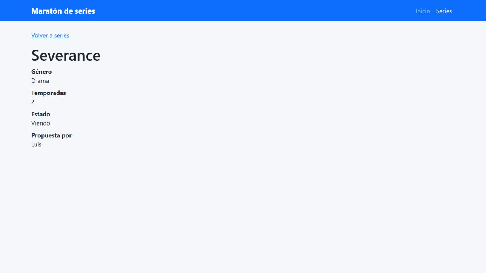

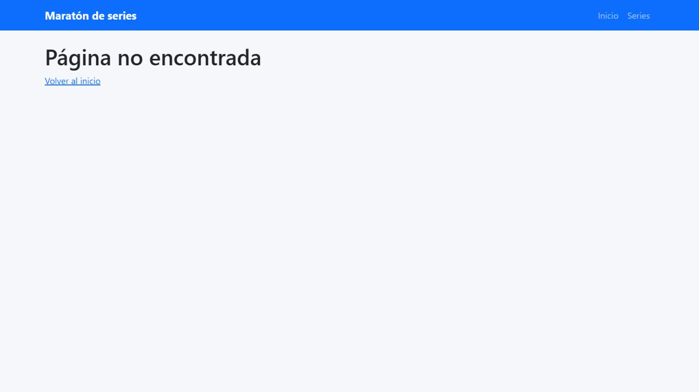

## 19. EF Core y SQL Server

Código: `maraton-series/servidor-net`.

### Explique el recorrido

| #   | Pieza                 | Qué hace                                                    |
| --- | --------------------- | ----------------------------------------------------------- |
| 1   | Kestrel / puerto 5090 | Recibe la petición GET.                                     |
| 2   | MapGet /api/series    | Selecciona el manejador de lectura.                         |
| 3   | AddDbContext          | Inyecta MaratonContext para esa petición.                   |
| 4   | Configuración privada | Lee ConnectionStrings:Maraton desde user-secrets o entorno. |
| 5   | OrderBy / Select      | Ordena y define exactamente los campos del contrato.        |
| 6   | ToListAsync           | EF traduce y ejecuta la consulta de forma asíncrona.        |
| 7   | SQL Server            | SELECT con JOIN a Generos y Miembros obtiene cinco filas.   |
| 8   | Objetos → JSON        | ASP.NET responde 200; ids numéricos se convierten a texto.  |

### Reflexiona y explicación

1. **FK y E1/E4.** La base exige que el miembro exista e impide borrar un proponente con series. Ambos experimentos devolvieron SQL 547.

2. **Favoritos muchos a muchos.** Un miembro tiene varios géneros y un género varios miembros. MiembroGeneros guarda cada pareja una vez con PK compuesta y dos FK.

3. **Migraciones y cadena.** El repositorio versiona Up, Down y snapshot para reconstruir el esquema. La cadena vive en user-secrets o entorno; .env y secretos no se entregan.

4. **Select de C#.** EF genera SELECT y JOIN a Generos y Miembros, proyectando solo columnas requeridas. Las consultas y los GET devolvieron los datos esperados.

5. **Cambio sin migración.** El experimento aislado amplió Titulo a 120 manteniendo el snapshot de 100. EF rechazó Migrate con PendingModelChangesWarning. El modelo entregado conserva 100.

6. **Cliente y .NET.** Para los dos GET cambiaría VITE_API_URL; ids y campos tienen los mismos tipos. Para CRUD faltan rutas .NET, por eso el cliente completo continúa usando Express.

Correo único → IX_Miembros_Correo. Referencia miembroId → FK_Series_Miembros_MiembroId. Enum estado → CK_Series_Estado. Arreglo generosFavoritos → MiembroGeneros.

### Experimentos y observaciones

Ejecutados los seis experimentos: E1 FK=547, E2 UNIQUE=2601, E3 CHECK=547 y E4 RESTRICT=547, con rollback. El cambio de longitud sin migración fue rechazado por EF. Las dos migraciones reconstruyeron una base nueva con cinco series y cuatro miembros; se eliminó únicamente esa base desechable. La base del laboratorio permaneció intacta. Registro: pruebas-sql.json. Extra de apagar el servicio y reto opcional de calificaciones: no realizados.

### Capturas del resultado acumulativo

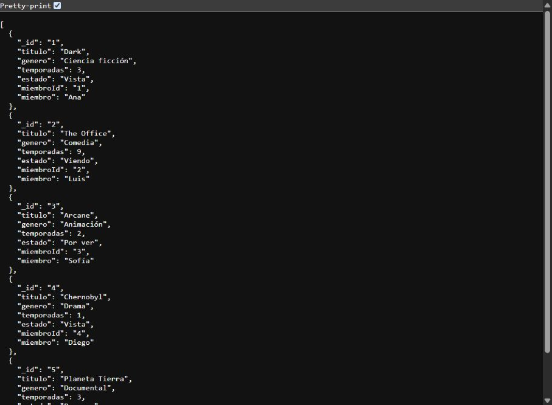

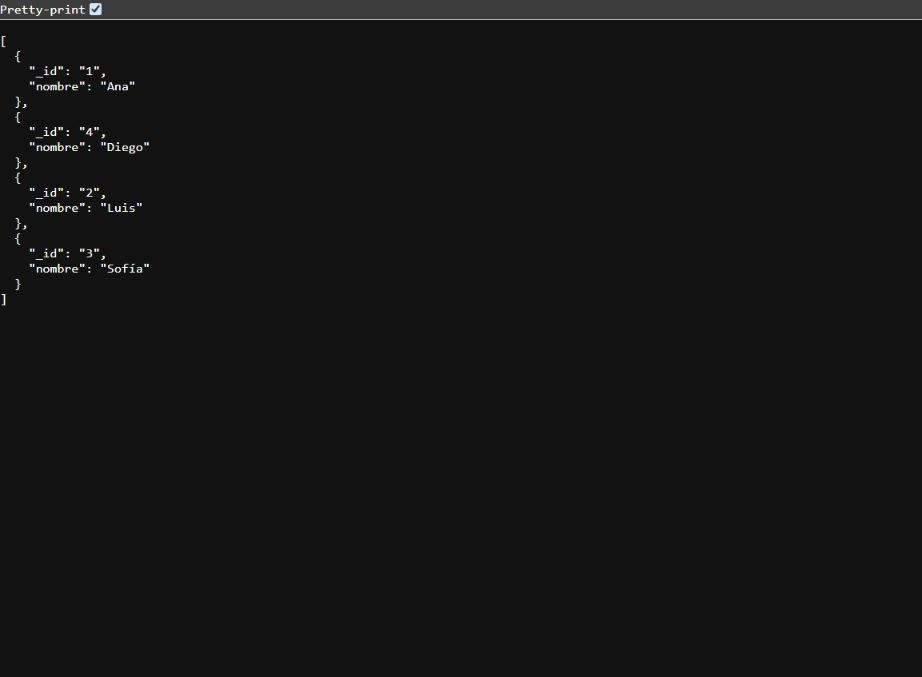

## 20. De HTML, Bootstrap y JavaScript a React — Pura Vida Tours

Código: `proyectos-base/pura-vida-tours/parte1-html` y `parte2-react`.

### Explique el recorrido

| #   | HTML y JavaScript                                          | React                                                                    |
| --- | ---------------------------------------------------------- | ------------------------------------------------------------------------ |
| 1   | index.html carga Bootstrap y estilos propios.              | main.jsx importa Bootstrap antes del CSS propio.                         |
| 2   | DOMContentLoaded llama crearMenu, crearCards y crearTabla. | createRoot dibuja App.                                                   |
| 3   | getElementById obtiene los contenedores.                   | Navbar, Hero, ListaTours, TablaReservas y Footer delimitan cada sección. |
| 4   | forEach crea elementos y appendChild los agrega.           | map retorna elementos JSX con key estable.                               |
| 5   | obtenerColorEstado elige el badge.                         | Se conserva la función JavaScript de colores.                            |

### Preguntas de reflexión

1. **Bootstrap compilado.** Permite empezar sin configurar Sass; las variables CSS bastan para personalizar el color. Sass conviene cuando se necesitan personalizaciones del framework antes de compilar o reducir componentes incluidos.
2. **getElementById.** En HTML se manipula el contenedor directamente. React recibe una descripción JSX y administra sus elementos; solo el montaje necesita localizar root.
3. **forEach y map.** forEach ejecuta acciones y no devuelve la lista transformada. map devuelve los elementos que JSX puede presentar.
4. **key.** Identifica un hermano de forma única y estable. Repetirla puede provocar advertencias y reconciliación incorrecta.
5. **Limitación sin props.** Los datos están dentro de cada componente; para reutilizar una misma tarjeta con datos recibidos habría que introducir props, tema de la siguiente etapa.

### Experimentos y observaciones

Ejecutado: ambas versiones mostraron cuatro enlaces, tres tours y cuatro reservas con estados Confirmada, Pendiente y Cancelada. La versión React compiló correctamente. Las fotografías de ejemplo cargaron del servicio indicado en la guía. No se agregaron los cinco ejercicios adicionales a la versión base. También se probaron ambas versiones con viewport de 390 px: las tarjetas quedaron en una columna y el botón de menú abrió los cuatro enlaces.

